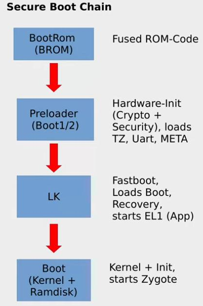
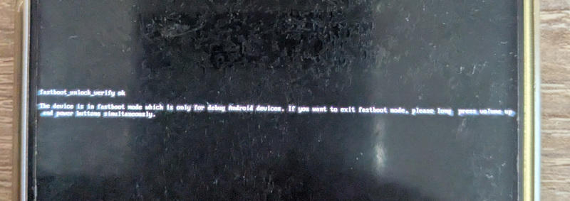
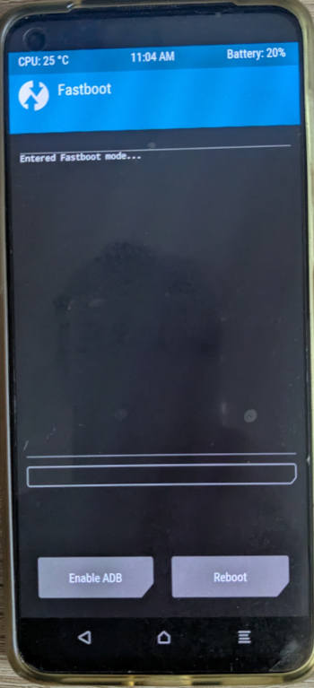
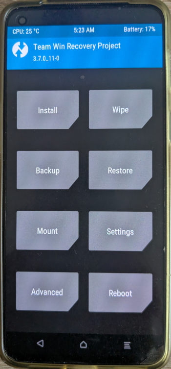
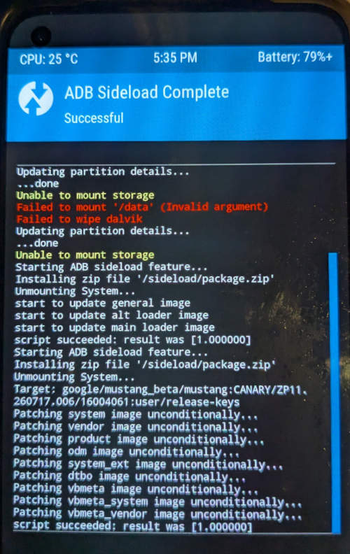

- [Introduction](#introduction)
  - [What is this](#what-is-this)
  - [Disclaimer](#disclaimer)
  - [About the boot sequence](#about-the-boot-sequence)
- [Official instructions](#official-instructions)
- [Pre-requisites](#pre-requisites)
  - [Handle your data and primary phone](#handle-your-data-and-primary-phone)
  - [Install tools on ubuntu](#install-tools-on-ubuntu)
- [Downgrade to OxygenOS 11](#downgrade-to-oxygenos-11)
  - [Device variants](#device-variants)
  - [Download the downgrade package](#download-the-downgrade-package)
  - [Transfer package to the phone](#transfer-package-to-the-phone)
  - [Install downgrade package](#install-downgrade-package)
- [Install firmware and custom ROM](#install-firmware-and-custom-rom)
  - [Backup partitions (optional)](#backup-partitions-optional)
  - [Activate developer mode on your phone and more](#activate-developer-mode-on-your-phone-and-more)
  - [Unlock bootloader](#unlock-bootloader)
  - [Download TWRP, firmware, ROM](#download-twrp-firmware-rom)
  - [Flash TWRP](#flash-twrp)
  - [Flash firmware and ROM](#flash-firmware-and-rom)
  - [Format data](#format-data)
  - [Reboot](#reboot)
- [Play integrity](#play-integrity)
  - [Verify current play integrity status](#verify-current-play-integrity-status)
  - [Improve play integrity](#improve-play-integrity)
- [Testing sheet](#testing-sheet)
  - [Conditions](#conditions)
  - [Communication](#communication)
  - [Peripherals](#peripherals)
  - [Phone basics](#phone-basics)
  - [Applications and security](#applications-and-security)
- [Troubleshooting](#troubleshooting)
  - [4g and 5g internet not working](#4g-and-5g-internet-not-working)
  - [Mtkclient troubleshooting](#mtkclient-troubleshooting)
    - [Mtkclient on windows](#mtkclient-on-windows)
    - [Mtkclient : Illegal instruction](#mtkclient--illegal-instruction)


# Introduction

[Go to github page display (better for reading)](https://ptrovatelli.github.io/android-custom-rom-guides/evolution-x-one-plus-nord-2.html)

[Go to github display (better for opening issues and merge requests)](https://github.com/ptrovatelli/android-custom-rom-guides/blob/main/evolution-x-one-plus-nord-2.md)

## What is this

This is a step by step guide on how to install **evolution-x rom on a one plus nord 2** phone currently on stock rom, with the lastest patched applied.

The latest patches date early 2026 as this device is not receiving any updates on the stock android (**stock device stuck at android 13 security patch january 2026** DN2103_11_F.59)

This article assumes that you have an **ubuntu PC** at hand. Of course windows/mac/other linux is possible but some commands will need to be adapted

In evolution-x, this device is in the `op6893` tree, device `denniz`. 

At the time of writing this article, evolution-x is based on android 16, with monthly security patches applied

Please feel free to open issues or merge requests to fix anything.

## Disclaimer

This gives more detailed instructions than the official documentation and could be of great help if you've never installed a custom ROM before.

You should know that trying to install a custom ROM could brick your phone and make it useless, although there are often ways to fix an apparently bricked phone, provided you have the time and skills.

## About the boot sequence

It may be useful to have a basic understanding of android boot sequence



(Schema from [mtk client in depth learning video](https://www.youtube.com/watch?v=NulWJo2RSKE&feature=youtu.be))

- **BootRom (BROM)**
  - this is very early in the boot sequence. Nothing is still displayed on the phone screen
    - an apparently bricked phone with nothing displayed on screen (failed preloader) can still be recovered from BROM with mtkclient. However note that the exloits that made mtkclient fully functional were fixed in recent firmwares.
- Fastboot, fastbootd
  - **Fastboot** = **bootloader**
    - from here we can unlock the bootloader but **this feature is blocked on oos 12+**
  
  
  
  - **FastbootD** : 
    - like fastboot but with less possibilities. Still possible with oos13.
    - you can flash some partitions but not all 
  
  
- Boot
  - Then the phone boots, either through the regular boot image or through the recovery image

Example when booting to recovery partition with TWRP: 



# Official instructions

As a reference, find below the official sources of information: 

- [Page for this device on evolution-x official website](https://evolution-x.org/device/op6893)
- [xda forum page for evolution-x on this device](https://xdaforums.com/t/rom-op6893-a16-evolutionx-official-for-oneplus-nord-2-5g-and-realme-x7-max-5g.4796652/)

- telegram channels:
  - [telegram support channel for One plus nord 2](http://t.me/OnePlusNord2GlobalOfficial)  (linked by xda page)
    - In the channel, type `/notes` to get a list of tutorials
  - [telegram evolution-x channel](https://t.me/EvolutionX)

- [evolution-x github repository](https://github.com/evolution-x)

- [evolution-x wiki](https://wiki.evolution-x.org/)

  

This article is worth mentioning too, not sure everything is up to date though: [Nord2Guides.md](https://gist.github.com/Giovix92/c7e69123dbc51adf3f3a26f9c3c0208e#file-nord2guides-md)

# Pre-requisites

## Handle your data and primary phone

If this is currently your primary phone, you may want to get another phone while you're working on this one because it may take time for everything to work as you would expect. 

It's possible to make a full backup of your phone (see next paragraph) but I haven't tested it.

What I have done: 

- Backed up my photos/videos to external drive (always a good idea)
- Got another phone. Transfered all data to this other phone after a factory reset of this other phone using android native feature (after the factory reset, the new phone asks if you want to get data from another phone)

## Install tools on ubuntu

Install adb and fastboot to communicate with the phone:

```
sudo apt-get install android-tools-adb
sudo apt-get install android-tools-fastboot
```

# Downgrade to OxygenOS 11

Latest OxygenOS 13 has locked the possibility to enter fastboot / bootloader mode. In order to do this, you first need to revert to OxygenOS 11.

## Device variants

**Beware that there are 2 regional variants of this device and 3 downgrade packages**: 

- DN2103
  - for europe : **EU** (beware that evolution-x displays DN2101 in place of DN2103) => **region XEU0000**
  - For north america: **NA** => **X00US00** (I haven't found any specific package; can probably use **GLO**)
  - and other countries (not india, not europe): **GLO** => **region 1EP0000**
- DN2101 for **India** => **region X00IN00**

Make sure your use the correct package. You can double-check your phone variant (DN2101/DN2103) in the phone parameters (software version)

You can check the region by dialling *#6776#

## Download the downgrade package 

Oneplus has stopped distributing this package, so we'll find it from the internet archive (aka wayback machine)

Original (dead) links were found from [https://community.oneplus.com/thread/1596759](https://community.oneplus.com/thread/1596759) and fed to the Wayback machine.

Direct (working) links: 

- [DN2103 / EU](https://web.archive.org/web/20230207132242/https://oxygenos.oneplus.net/oplus_ota_downgrade_EU.zip)

```
sha256sum 'oplus_ota_downgrade_EU'
3db05626498716191c570dadc08d90adcca0fca5c35a997778a34454c6f64ead  oplus_ota_downgrade_EU.zip

du -h 'oplus_ota_downgrade_EU.zip'
3,6G	oplus_ota_downgrade_EU.zip
```

- [DN2103 / GLO](https://web.archive.org/web/20221117114244/https://oxygenos.oneplus.net/oplus_ota_downgrade_NA.zip)  (to be tested)
- [DN2101 / India](https://web.archive.org/web/20230207132242/https://oxygenos.oneplus.net/oplus_ota_downgrade_Nord2Rollback.zip) (to be tested)

```
sha256sum 'oplus_ota_downgrade_Nord2Rollback.zip'
b6282ffdce167b71dfd9bb3c80160b4c4bdd4f8b8d654876b4d811c502247e59  oplus_ota_downgrade_Nord2Rollback.zip

du -h 'oplus_ota_downgrade_Nord2Rollback.zip'
3,7G	oplus_ota_downgrade_Nord2Rollback.zip
```

Rename to `oplus_ota_downgrade.zip` after download


Alternatively, you can check this method in telegram notes: [download_oplus_rollback](http://t.me/MissRose_bot?start=notes_-1001596273500_1944257)

## Transfer package to the phone

Copy the file to the root of your phone storage (plug the phone via usb to the PC for example and when the phone asks what to do with this connexion choose "transfer files")

## Install downgrade package

We'll install the package using **local install**

See also in telegram */notes* : 

- [local_install_fix](http://t.me/MissRose_bot?start=notes_-1001596273500_1944259)
- [downgrade_instructions](http://t.me/MissRose_bot?start=notes_-1001596273500_1409105)


1. **The "Anti-Crash" protocol in settings:**
   - Enable **Airplane Mode** on your phone (crucial to cut off Wi-Fi and mobile data).
   - Go to *Settings > Apps > App management*.
   - Tap the three dots in the top-right corner and select **"Show system"**.
   - Look for the app named **"Software Update"** (or *com.oplus.ota*).
   - Go to *Storage usage* and tap **Clear data**.
2. **Initiate the Downgrade:**
   - **Keep Airplane Mode enabled**.
   - Go to *Settings > About device*.
   - Tap the large **OxygenOS** banner at the top (the menu that usually checks for updates).
   - Tap the **three dots** in the top-right corner.
   - The **Local install** option will no longer be greyed out and will become visible.
   - Select your `.zip` file and begin the installation.

3. Launching the Downgrade

   - Open the **System Update** app (which was just installed, either named *System Update* or showing a gear icon).

   - Tap the **gear icon** (or the three dots) in the top-right corner.

   - Select **Local upgrade**.

   - The app will automatically detect the downgrade `.zip` file you placed in the root directory during Step 1. Select it.

   - A warning message will appear to remind you that all your data will be erased. Confirm the action.

   - Let the installation process run until it finishes (this can take 5 to 10 minutes).

   - As soon as the installation reaches 100%, tap **Restart**.


**Troubleshooting**

If you keep having **Verification failed** error, try to factory reset the phone and put it in English language.

# Install firmware and custom ROM

## Backup partitions (optional)

This is optional but could prove useful as those can be hard to find. Installing mtkclient may take a bit of time though.

**Note that I have not tested this procedure while the device was in that state. Please tell me if it works or not.**

- [Install mtkclient](https://github.com/bkerler/mtkclient#installation) (in case of issue see [Mtkclient troubleshooting](#mtkclient-troubleshooting))
- Backup all partitions to `out` folder except user data (add `--preloader` if in brom). 
  - Here we skip user data backup for a faster process. You can back it up too if you wish, but I don't think you could restore your personal data easily on evolution-x. It would probably be more usable in case you want to return back to the original ROM.

``` 
python mtk.py rl out --skip userdata
```

- Backup preloader (from brom mode)

```
mtk.py r preloader preloader.bin --parttype boot1
mtk.py r preloader preloader.bin --parttype boot2
```

- Backup brom (from brom mode)

```
python mtk.py dumpbrom
```

## Activate developer mode on your phone and more

Step 1: Enable Developer Mode

1. Open the **Settings** app on your phone.
2. Scroll down and tap on **About device**.
3. Select **Version**.
4. Find **Version number** (or Build number) and tap it **7 times** in a row.
5. Enter your device's **PIN, pattern, or password** when prompted.
6. You will see a confirmation message at the bottom stating: *"You are now in developer mode"* (or *"You are now a developer"*).

Step 2: Enable USB Debugging

1. Go back to the main **Settings** menu.
2. Scroll down and tap on **System & updates** (or **Additional settings** depending on your sub-version).
3. Select **Developer options**.
4. Scroll down the list to find **USB debugging** and tap the toggle switch to turn it on.
5. Tap **OK** on the security warning prompt to confirm.

Step 3: OEM unlocking

1. Open **Settings**.
2. Tap on **Additional settings** (or **System & updates**).
3. Open **Developer options**.
4. Scroll down a bit and locate **OEM unlocking** (or *Enable OEM unlock*).
5. Toggle the switch to **On**.
6. Enter your lock screen **PIN or password** to authorize the change.
7. Tap **Enable** on the confirmation warning pop-up.

## Unlock bootloader

After reboot to OOS 11, configure briefly your phone without setting your accounts:

1. Plug the phone to your PC

3. Run

   ```
   adb reboot bootloader
   ```

Phone should enter **Fastboot Mode**. 

On ubuntu type in: 

``````
fastboot flashing unlock
``````

Validate with volume up.

## Download TWRP, firmware, ROM

- Download the latest TWRP image from [https://dl.twrp.me/denniz/](https://dl.twrp.me/denniz/)
  - *Note that you cannot use the recovery partition delivered with evolution-x because it is not compatible with oos 11*
- Download android 13 modified firmware from [internet archive](https://archive.org/download/rmx3031-firmware-f-57-restore-brom/13.0-F.57-Denniz_Restore_Brom_Firmware.zip) or [github](https://github.com/ManshuTyagi/releases/releases/download/firmware/13.0-F.57-Denniz_Restore_Brom_Firmware.zip)

```
sha256sum 13.0-F.57-Denniz_Restore_Brom_Firmware.zip
fdc4dfccfb12b595e46fba618d7b22f49a4bbc4e61234e3838c124527a2e7e01  13.0-F.57-Denniz_Restore_Brom_Firmware.zip

du -h 13.0-F.57-Denniz_Restore_Brom_Firmware.zip
58M	13.0-F.57-Denniz_Restore_Brom_Firmware.zip
```

---
**NOTE**

This package is refered to as ["the firmware with Restore Brom - Based on  https://gist.github.com/Giovix92/c7e69123dbc51adf3f3a26f9c3c0208e#restore-brom"](https://github.com/ManshuTyagi/releases/releases/tag/firmware). It contains: 

- part of the original oos13 DN2103_11.F.57_2570_202510142204 firmware with many files omitted (original firmware is about 6GB). Its purpose is to make it possible to flash an android 14+ ROM while on android 11
- The content of [bulletproof_denniz.zip](https://sourceforge.net/projects/giovix92-builds/files/denniz/extras/bulletproof_denniz.zip/download) : 
  - **Lk, Lk2 from android 11**, where fastboot worked (probably not needed in our case as fastboot is already functional)
  - **preloader_ufs from oos 12 C.01** where brom exploit wasn't fixed (make it possible to fully use mtkclient). May not be needed in our case (brom exploit works on oos 11). Might be required in order to flash A16 ROM on oos11.

---


- Download evolution-x ROM from [https://evolution-x.org/device/op6893](https://evolution-x.org/device/op6893)

## Flash TWRP

TWRP is an app that will help us install the firmware and the ROM to the device

Switch to **fastbootd mode**

```
fastboot reboot fastboot
```

Flash the TWRP image to the recovery partition with:  

```
fastboot flash recovery twrp-3.7.0_11-0-denniz.img
```

Reboot the phone to recovery to run TWRP on the phone:

```
fastboot reboot recovery
```

## Flash firmware and ROM

As we are now on OxygenOs 11 (with oos 11 firmware) and we want to install an android 16 ROM, we need to first upgrade to a more recent firmware. It's possible to install android 16 over an android 13 firmware, which is why we have downloaded an android 13 firmware.

**You must flash both the firmware and the ROM without rebooting in between**

In TWRP, before starting wipe data

- wipe / advanced : 

  - dalvik

  - data

  - cache

- Go to Advanced / ADB Sideload
- Swipe the "**Swipe to Start Sideload**" cursor so that twrp will wait for the PC to push an image

On ubuntu push the firmware using adb:

```
adb sideload 13.0-F.57-Denniz_Restore_Brom_Firmware.zip
```

Wait for TWRP to finish processing it, then push the ROM, for example:

```
adb sideload EvolutionX-16.0-20260919-op6893-11.11-Official.zip
```

It's possible that you see `Failed to mount '/data' (Invalid argument)` error while the operation is still successfull. Check that at least last line is `script succeeded`. Example:




## Format data

In TWRP, go to **wipe menu / format data**

## Reboot

Reboot. 

The Phone should now run Evolution-x!

# Play integrity
## Verify current play integrity status

Download and install **Play Integrity API Checker** from the Play Store.

Initial status: 

- MEETS_BASIC_INTEGRITY: <span style="color:green">green</span>
- MEETS_DEVICE_INTEGRITY: <span style="color:red">red</span>
- MEETS_STRONG_INTEGRITY: <span style="color:red">red</span>

## Improve play integrity

There seems to be an issue with the spoofing components at the moment (end October / November 2026) after some changes on google side.

Reaching device or strong integrity is probably doable with rooting + specific modules (just what you would do on any other ROM), if you don't mind the loss of security that rooting will bring.

# Testing sheet

## Conditions

Tested on evolution-x 11.11, build BP4A.251205.006.

Device One plus nord 2 DN2103

Date: oct/nov 2026.

## Communication

| What                     | Test                                                         | Result                              |
| ------------------------ | ------------------------------------------------------------ | ----------------------------------- |
| wifi                     | Cut out data and access internet on wifi                     | <span style="color:green">**OK**</span> |
| internet access (4g)     | (switch favorite network to 4G if you're stuck on 5G). <br/>(see note 1) | <span style="color:green">**OK**</span> |
| internet access (5g)     | (see note 1)                                                 | <span style="color:green">**OK**</span> |
| hotspot (4G->wifi)       | (switch favorite network to 4G if you're stuck on 5G).       | <span style="color:green">**OK**</span> |
| hotspot (5g->wifi)       |                                                              | <span style="color:green">**OK**</span> |
| hotspot (wifi->wifi)     |                                                              | <span style="color:green">**OK**</span> |
| VOLTE (voice over 4G)    | Make sure you're now on 4G (switch favorite network to 4G if you're stuck on 5G).<br/>Initiate a call and keep it active for 10 seconds.<br/>Make sure you're still on 4G | <span style="color:green">**OK**</span> |
| VONR (voice over 5G)     | Make sure you're now on 5G.<br/>Initiate a call and keep it active for 10 seconds.<br/>Make sure you're still on 5G | <span style="color:green">**OK**</span> |
| VOWIFI (voice over wifi) | Check option is present in parameters (was deactivated out of the box)<br/>Cut out data. Make a call. Check that "WIFI call in progress" is displayed (hard to be 100% sure) | <span style="color:green">**OK**</span> |

**Note 1**: if you have an exclamation mark besides your "4G/5G" icon, see [4g and 5g internet not working](#4g-and-5g-internet-not-working)

## Peripherals

| What               | Test                                                         | Result                                   |
| ------------------ | ------------------------------------------------------------ | ---------------------------------------- |
| gps                | GPS guiding in a car                                         | <span style="color:green">**OK**</span>  |
| camera             | Quick test: take one picture front camera, one back camera. Take a quick movie | <span style="color:green">**OK**</span>  |
| nfc                | TODO                                                         | <span style="color:gray">**TODO**</span> |
| fingerprint sensor | Configure phone unlock with fingerprints                     | <span style="color:green">**OK**</span>  |
| facial recognition | Configure phone unlock with facial recognition               | <span style="color:green">**OK**</span>  |

## Phone basics

| What         | Test                                                         | Result                                  |
| ------------ | ------------------------------------------------------------ | --------------------------------------- |
| vibrate mode | Receive call with vibrate mode                               | <span style="color:green">**OK**</span> |
| warp charge  | Make sure phone completely charge within about 35mn with appropriate cable | <span style="color:green">**OK**</span> |

## Applications and security

| What                    | Test                                                         | Result                                      |
| ----------------------- | ------------------------------------------------------------ | ------------------------------------------- |
| Play integrity          | Download and run Play Integrity API Checker                  | <span style="color:orange">**Basic**</span> |
| google apps             | Google authenticator                                         | <span style="color:green">**OK**</span>     |
|                         | Google drive                                                 | <span style="color:green">**OK**</span>     |
|                         | Gmail                                                        | <span style="color:green">**OK**</span>     |
| yubikey                 | Authenticating to a website using a yubikey                  | <span style="color:green">**OK**</span>     |
| microsoft authenticator |                                                              | <span style="color:green">**OK**</span>     |
| banking apps            | Most will probably not work (see [Improve play integrity](#improve-play-integrity)) | <span style="color:red">**KO**</span>       |

# Troubleshooting

## 4g and 5g internet not working

If internet is not working and you see an exclamation mark besides your "4G/5G" icon, check your APN settings in order to select your correct carrier. It may be incorrect out of the box.

## Mtkclient troubleshooting

### Mtkclient on windows

It seems that mtkclient is not working on Windows at the moment (november 2026) after a windows update. It might be fixed in the future.

### Mtkclient : Illegal instruction

On any mtkclient call, standard output: 

```` 
Illegal instruction    (core dumped) python mtk_gui.py
````

dmesg:

```` 
[ 1608.107669] traps: python[13220] trap invalid opcode ip:7bef3fb889b9 sp:7ffc335dbe30 error:0 in libshiboken6.abi3.so.6.12[379b9,7bef3fb63000+35000]
````


The mtkclient gui components require cpu fetaures `SSE4.1` /`SSE4.2`. If your cpu is very old, you may miss those. 

To verify, check cpu flags in:

```
lscpu | grep -i sse
```

If you miss `sse4_1 sse4_2`,  you must uninstall graphical elements in mtkclient and not use the GUI: 

```
pip uninstall -y PySide6 shiboken6	
```
